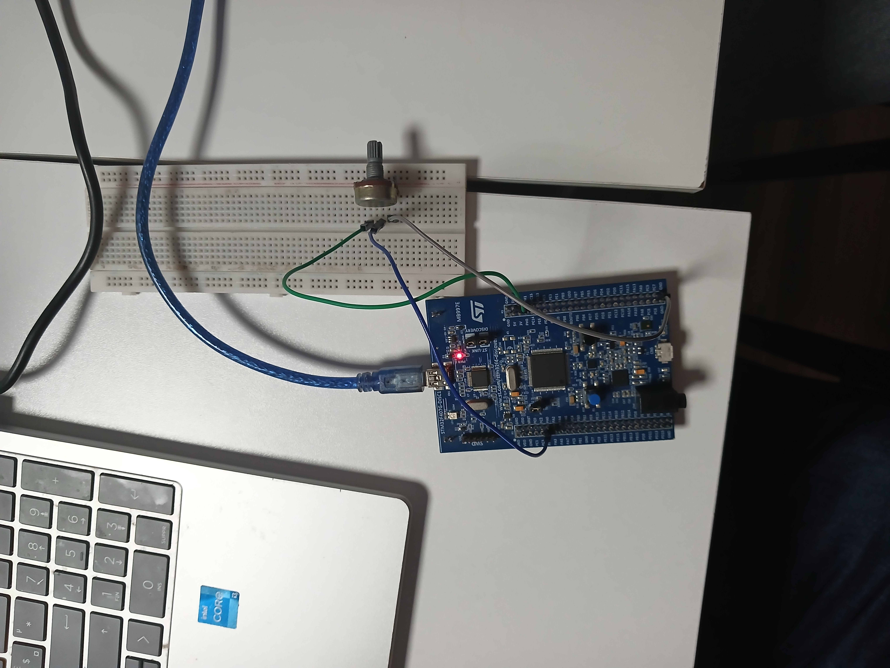
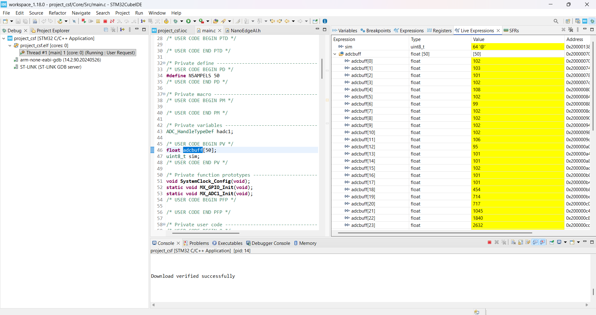
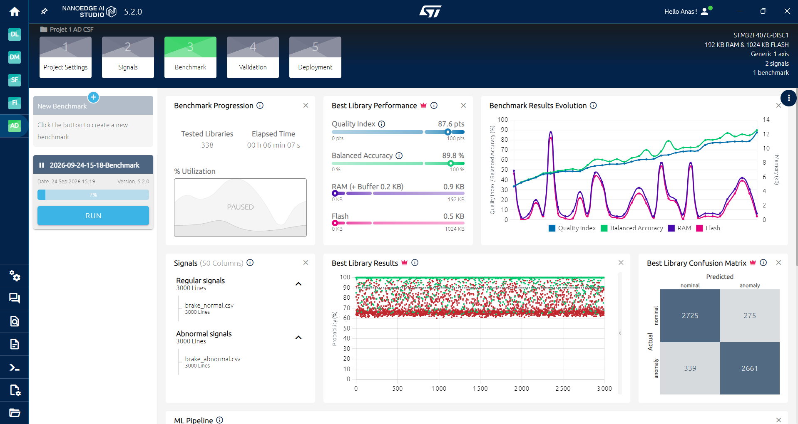

# STM32-Based Brake Signal Anomaly Detection Using Edge AI

**Embedded Systems · Edge AI · STM32 · C · NanoEdge AI Studio**

An embedded AI project developed during a technical workshop, focused on detecting anomalies in brake-related signals using an STM32 microcontroller and a machine learning library generated with NanoEdge AI Studio.

The system acquires analog signals through the STM32 ADC, processes fixed-size signal windows, and uses an embedded anomaly detection model to distinguish nominal signal patterns from anomalous ones.

## Table of Contents

- [Project Overview](#project-overview)
- [Key Features](#key-features)
- [Hardware Requirements](#hardware-requirements)
- [Software and Technologies](#software-and-technologies)
- [System Architecture](#system-architecture)
- [Project Gallery](#project-gallery)
- [Dataset](#dataset)
- [AI Model Training and Benchmark Results](#ai-model-training-and-benchmark-results)
- [Confusion Matrix](#confusion-matrix)
- [Repository Structure](#repository-structure)
- [Getting Started](#getting-started)
- [Limitations and Future Improvements](#limitations-and-future-improvements)
- [Acknowledgments](#acknowledgments)
- [Disclaimer](#disclaimer)

## Project Overview

The objective of this project is to explore the deployment of lightweight machine learning models directly on microcontrollers, enabling local inference without requiring cloud computing.

The prototype uses an **STM32F407G-DISC1** development board. A potentiometer serves as an analog signal source for experimental signal acquisition. The acquired samples are organized into windows and intended for processing by an anomaly detection library generated with NanoEdge AI Studio.

The project combines embedded C programming, analog-to-digital conversion, signal acquisition, machine learning, and microcontroller debugging.

## Key Features

- Analog signal acquisition using the STM32 ADC.
- Fixed-size signal windows containing 50 samples.
- Anomaly detection using NanoEdge AI Studio.
- Integration of an embedded AI library into STM32 firmware.
- Firmware development and debugging with STM32CubeIDE.
- Evaluation of classification performance using a confusion matrix.
- Analysis of estimated AI library memory requirements.

## Hardware Requirements

| Component | Description |
|---|---|
| Microcontroller board | STM32F407G-DISC1 |
| Analog signal source | Potentiometer |
| Signal acquisition | STM32 ADC |
| Debugging interface | ST-LINK |
| Development computer | PC running STM32CubeIDE |

The potentiometer is used to generate an experimental analog signal. It does not reproduce the complete behavior of a real automotive braking system.

## Software and Technologies

| Technology | Purpose |
|---|---|
| C / Embedded C | Microcontroller firmware |
| STM32CubeIDE | Firmware development and debugging |
| STM32CubeMX | Peripheral configuration |
| STM32 HAL | Hardware abstraction and peripheral control |
| NanoEdge AI Studio 5.2.0 | Anomaly detection model generation and benchmarking |
| ST-LINK | Firmware programming and debugging |

## System Architecture

The prototype follows this general processing architecture:

```text
          Analog Signal Source
              Potentiometer
                   |
                   v
             STM32 ADC
                   |
                   v
          Signal Acquisition
                   |
                   v
          50-Sample Window
                   |
                   v
         NanoEdge AI Library
                   |
                   v
          Anomaly Detection
                   |
             +-----+-----+
             |           |
             v           v
          Nominal      Anomaly
```

The diagram represents the intended signal-processing flow. The exact inference sequence and output handling should be confirmed against the final firmware implementation.

## Project Gallery

### 1. Hardware Implementation

The STM32F407G-DISC1 development board is used with a potentiometer as an analog input source for testing the embedded signal acquisition system.



### 2. ADC Signal Acquisition and Debugging

The ADC buffer is inspected in STM32CubeIDE to observe acquired samples and examine the firmware's signal acquisition behavior during debugging.



### 3. NanoEdge AI Model Training and Benchmark Results

NanoEdge AI Studio provides the reported classification performance, quality index, estimated memory requirements, and confusion matrix for the anomaly detection library.



## Dataset

The NanoEdge AI Studio project uses two classes of signal data:

| Class | Number of signal windows | Samples per window |
|---|---:|---:|
| Nominal | 3,000 | 50 |
| Anomaly | 3,000 | 50 |
| **Total** | **6,000** | **50** |

Each signal window contains 50 samples from a single input axis.

The datasets are used to characterize nominal signal patterns and anomalous signal patterns during model development.

**Note:** Include the original CSV datasets in this repository only if you have permission to redistribute them.

## AI Model Training and Benchmark Results

The following results were obtained from my NanoEdge AI Studio benchmark session on **September 24, 2026**, targeting the STM32F407G-DISC1.

### Reported Performance

| Metric | Result |
|---|---:|
| Balanced accuracy | 89.8% |
| Quality index | 87.6 / 100 |
| Estimated RAM usage | 0.9 KB |
| Estimated Flash usage | 0.5 KB |
| Libraries tested | 338 |
| Elapsed benchmark time | 6 min 7 sec |

The benchmark was paused at **7% progression**. These values represent the best library reported at that point and should not be interpreted as the final result of a completed optimization and validation process.

The RAM and Flash values are NanoEdge AI Studio estimates for the AI library. They do not necessarily represent the total memory footprint of the firmware and application.

## Confusion Matrix

The reported benchmark produced the following classification results:

| Actual class | Predicted nominal | Predicted anomaly |
|---|---:|---:|
| Nominal | 2,725 | 275 |
| Anomaly | 339 | 2,661 |
| **Total** | **3,064** | **2,936** |

### Interpretation

- **2,725 nominal windows** were correctly classified as nominal.
- **2,661 anomalous windows** were correctly classified as anomalous.
- **275 nominal windows** were incorrectly classified as anomalies.
- **339 anomalous windows** were incorrectly classified as nominal.

The balanced accuracy calculated from the confusion matrix is approximately **89.8%**.

These results describe the reported evaluation and should not be interpreted as proof of performance on real-world automotive braking signals.

## Repository Structure

The repository is intended to follow this structure:

```text
stm32-brake-anomaly-detection/
├── Core/
│   ├── Inc/
│   └── Src/
├── Drivers/
├── Model/
├── dataset/
├── docs/
│   ├── project-setup.jpg
│   ├── adc-debug-output.png
│   └── model-training-results.png
├── project_csf.ioc
├── README.md
├── THIRD_PARTY_NOTICES.md
└── .gitignore
```

The firmware, generated model library, configuration files, and datasets should be added when available and when redistribution is permitted. Preserve the original STM32CubeIDE project structure where possible.

## Getting Started

### Prerequisites

- STM32CubeIDE
- STM32CubeMX, integrated into STM32CubeIDE or installed separately
- STM32F407G-DISC1 development board
- ST-LINK programming and debugging interface
- NanoEdge AI library and associated files, where redistribution and use are permitted

### Setup

1. Clone or download this repository.
2. Open the STM32CubeIDE project, once the complete project files have been added.
3. Verify the microcontroller target and peripheral configuration.
4. Check the ADC configuration and analog input wiring.
5. Ensure the NanoEdge AI header and compiled library are correctly integrated.
6. Build the firmware and resolve any configuration or linking errors.
7. Connect the board through ST-LINK and flash the firmware.
8. Use the debugger to inspect the ADC buffer and verify signal acquisition.
9. Validate the inference behavior using the implemented firmware and appropriate test signals.

**Reproducibility note:** The steps above describe the intended workflow. A successful build and deployment cannot be guaranteed until the complete firmware source, project configuration, and required AI library are present.

## Limitations and Future Improvements

- Complete the NanoEdge AI benchmark and validation stages.
- Document the exact signal acquisition and inference implementation.
- Measure inference latency and total application memory consumption on the target board.
- Validate the model using representative brake-related sensor signals.
- Evaluate false-positive and false-negative rates under different operating conditions.
- Document the complete firmware compilation, flashing, and testing procedure.
- Improve the repository documentation with wiring details and reproducible test results.

## Acknowledgments

This project was developed as part of a technical workshop involving STM32 microcontrollers and embedded AI.

STMicroelectronics and NanoEdge AI Studio are acknowledged for the development tools used in the project. Third-party code, libraries, datasets, and other resources must retain their applicable licenses and attribution notices.

## Disclaimer

This project is an **educational embedded AI prototype**. It is not a safety-certified automotive braking system and must not be used to control, certify, or validate safety-critical vehicle functions.
